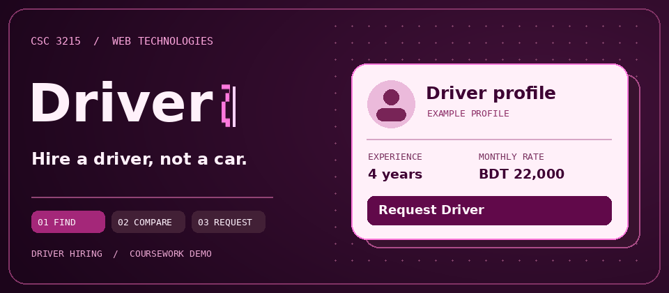

# DriverDen — Driver Hiring & Management System

A web platform connecting car owners, businesses, and private individuals with licensed, verified drivers for flexible hiring contracts.

DriverDen focuses on hiring drivers—not booking passenger seats. Clients can find suitable drivers for hourly engagements, full-day errands, outstation trips, and recurring monthly chauffeur contracts.

> Development status: This README describes the planned product scope and architecture. Feature availability and setup instructions will be updated as implementation progresses.

## Table of Contents

- [Overview](#overview)
- [Technology Stack](#technology-stack)
- [User Roles](#user-roles)
- [Core Features](#core-features)
- [Foundation Modules](#foundation-modules)
- [Database Design](#database-design)
- [Booking Lifecycle](#booking-lifecycle)
- [Getting Started](#getting-started)
- [Development Roadmap](#development-roadmap)
- [Contributing](#contributing)
- [License](#license)

## Overview

Finding a reliable driver involves more than checking availability. Clients need confidence in a driver's credentials, vehicle-handling skills, route familiarity, and professional conduct. Drivers also need clear contract terms, fair expense settlement, and accountability from clients.

DriverDen brings these needs into a single platform through:

- Verified driver profiles and credential tracking
- Search and matching based on skills, experience, rates, and availability
- Flexible booking and contract management
- Mutual reviews and formal dispute handling
- Expense records, financial summaries, and notifications
- Administrative oversight and safety intervention

## Technology Stack

| Layer | Technology / Approach |
|-------|------------------------|
| Backend | HTML |
| Database | MySQL |
| Architecture | Custom Model–View–Controller (MVC) |
| Access control | Role-based authentication |
| Version control | Git and GitHub |

Frontend tooling, supported runtime versions, and deployment requirements will be documented as the implementation is finalized.

## User Roles

### Client

- Browse and filter driver profiles.
- Review skills, experience, ratings, and availability.
- Create and manage hiring requests.
- Bookmark trusted drivers in a personal “My Fleet” roster.
- Review expenses and hiring history.
- Rate drivers and report booking-related issues.

### Driver

- Create a profile with license details, experience, and specialist skills.
- Manage availability and duty status.
- Accept, decline, or counter hiring requests.
- Track completed work, earnings, and reimbursable expenses.
- Review clients and report safety or payment concerns.
- Request an emergency substitute when necessary.

### Administrator

- Verify driver profiles and credentials.
- Moderate accounts and address misconduct.
- Review complaints and arbitrate disputes.
- Oversee platform activity and safety interventions.

## Core Features

The following 12 features define the planned core product.

| # | Feature | Description |
|---|---------|-------------|
| 1 | Flexible Booking Scopes | Support hourly, full-day, multi-day outstation, and recurring monthly driver contracts. |
| 2 | Transmission & Vehicle Skills | Record manual and automatic transmission expertise, luxury vehicle handling, armored vehicle clearance, and commercial             transport capabilities. |
| 3 | “My Fleet” Bookmarks | Let clients save trusted drivers and prioritize their private shortlist for future hiring requests. |
| 4 | Disputes & Escalation | Link complaints to specific bookings for issues such as route deviations, vehicle damage, payment withholding, or safety concerns. |
| 5 | Credential Tracking | Track license expiry and verification status, provide advance reminders, and restrict drivers with expired credentials. |
| 6 | Detailed Driver Ratings | Evaluate punctuality, vehicle care, route efficiency, and professional conduct rather than relying only on a single overall score.|
| 7 | Mutual Reviews | Allow drivers to review client conduct, payment timeliness, workplace safety, and vehicle reliability. |
| 8 | Expense Settlement | Record itemized fuel, toll, parking, and authorized overtime expenses alongside base compensation. |
| 9 | Booking Status Notifications | Notify users when requests are sent, accepted, activated, disputed, or completed. |
| 10 | Availability Calendar | Track available dates and duty states such as active shift, outstation assignment, and off-duty. |
| 11 | Emergency Substitute Handoff | Support reassignment during an emergency while preserving relevant contract terms. |
| 12 | Route & Terrain Expertise | Tag familiarity with urban traffic, highways, mountainous routes, and border-related requirements. |

## Foundation Modules

### Authentication & Access Control

Role-based access for clients, drivers, and administrators, with secure password hashing, session management, and account recovery.

### Driver Onboarding

Structured profile creation covering contact information, a profile photo, license details, and years of service.

### Driver Directory

A searchable directory with filters for rates, experience, ratings, and current availability.

### Booking & Response Management

A booking workflow covering pickup and drop-off points, scheduling, contract terms, and driver responses.

### Notification Center

A centralized inbox for booking updates, system notices, and verification-related alerts.

### Dashboards & Financial Summaries

- Client dashboard for active engagements, upcoming bookings, pending requests, and quick rehiring.
- Driver dashboard for shift history, completed trips, earnings, tips, and reimbursable expenses.
- Administrative dashboard for verification, moderation, and dispute resolution.

## Database Design

The specification identifies the following principal entities and supporting relationship table:

| Table | Purpose |
|-------|---------|
| `users` | Account information and user roles |
| `driver_profiles` | Driver credentials, skills, experience, verification, and availability |
| `hiring_requests` | Booking details, contract status, expenses, and substitute handoffs |
| `reviews` | Role-aware ratings and feedback |
| `reports` | Complaints, disputes, and escalation records |
| `notifications` | User alerts, event types, and read status |
| `saved_drivers` | Relationships between clients and their bookmarked drivers |

The specification describes six core relational entities and separately references `saved_drivers` for “My Fleet” bookmarking. The final schema should reconcile this distinction during database design.

### Planned Data Integrity Approach

- Use foreign keys to maintain valid relationships between records.
- Use transactions for related multi-step updates.
- Link reviews and reports to the relevant users and bookings.
- Link substitute assignments to their original hiring request.
- Keep expense information associated with its booking.

The final schema, migrations, indexes, and deletion rules will be documented alongside the implementation.

## Booking Lifecycle

The primary booking flow is:

```text
Request Sent → Accepted → Active Transit → Completed
```

Additional workflows include:

- Declining or countering a request before acceptance
- Opening a dispute associated with a booking
- Reassigning a contract through an emergency substitute handoff

Status changes are intended to generate notifications for the relevant users.

## Getting Started

### Clone the Repository

```bash
git clone [https://github.com/raisa0411/fall-26-27-DriversDen-management-system.git](https://github.com/raisa0411/fall-26-27-DriversDen-management-system.git)
cd fall-26-27-DriversDen-management-system
```

### Local Setup

The application is planned for HTML and MySQL using a custom MVC architecture.

Detailed setup instructions will be added when the project structure is available, including:

1. Required HTML and MySQL versions
2. Required HTML extensions
3. Web server and document-root configuration
4. Database creation and schema import or migrations
5. Local configuration and environment variables
6. Development startup commands
7. Test execution instructions

Do not commit database passwords, API keys, or other private credentials to the repository.

## Development Roadmap

### Phase 1 — MVP

- [ ] Establish the custom MVC application structure.
- [ ] Finalize the relational database schema.
- [ ] Implement authentication and role-based access.
- [ ] Build driver onboarding and verification.
- [ ] Implement the searchable driver directory.
- [ ] Develop booking and driver-response workflows.
- [ ] Implement the 12 core features.
- [ ] Add dashboards and administrative moderation.
- [ ] Configure email notifications.
- [ ] Test booking, review, expense, and dispute workflows.

### Phase 2 — Growth

- [ ] Integrate digital escrow payments.
- [ ] Add in-app calling or phone-number masking.

Potential payment integrations identified in the specification include Stripe, SSLCommerz, and bKash. Provider selection and integration details remain to be finalized.

### Phase 3 — Enterprise

- [ ] Add corporate accounts and multi-driver hiring.
- [ ] Support pooled corporate billing.
- [ ] Introduce live GPS tracking for active contracts.

### Additional Proposed Enhancements

- [ ] Driver health and vision verification badges
- [ ] Rate estimates based on duration, terrain, demand, night driving, and vehicle class

## Contributing

1. Fork the repository.
2. Create a feature branch:

   ```bash
   git checkout -b feature/your-feature-name
   ```

3. Implement and test your changes.
4. Commit with a clear message:

   ```bash
   git commit -m "Describe your changes"
   ```

5. Push to your fork:

   ```bash
   git push origin feature/your-feature-name
   ```

6. Open a pull request explaining the changes and referencing any related issue.

For major changes, open an issue first to discuss the scope and approach.

## License

A project license has not yet been specified in this README. Add the selected license and a corresponding `LICENSE` file before distributing the project under explicit license terms.


# Driver দেন
### Driver Hiring Management System

> **Hire a driver, not a car.**

**CSC 3215 · Web Technologies**  
American International University–Bangladesh · Fall 2026–27

[Overview](#project-overview) · [User roles](#user-roles) · [Booking lifecycle](#booking-lifecycle) · [Technology](#technology) · [Database](#database-design) · [Demo walkthrough](#demo-walkthrough)

---

## Project overview

**Driver দেন** comes from **ড্রাইভার দেন** — “Give me a driver.” The project connects people who need someone to drive with drivers who offer services. A vehicle type on a driver profile tells the customer what that driver can operate; it is not a vehicle listing or a rental offer.

A customer can search for a driver, compare two drivers for the same service, calculate an estimated base amount, submit a hiring request, and review a completed hire. The broader system design covers what happens behind that customer journey: drivers set their availability, agencies act on behalf of affiliated drivers when authorised, and administrators oversee verification and disputed records.

The project has two parts:

| Part | What it covers |
| --- | --- |
| **Frontend coursework prototype** | The pages and browser-side interactions, including the customer workflow described below. |
| **Relational database design** | The records, relationships, rules, and audit history needed to support the wider four-role system. |

The browser demo is not presented as a live service or as connected to the database.

## User roles

Driver দেন is designed around **four user roles**. Each has a different responsibility and should see or change only the records relevant to that role.

| Role | Main responsibility | Typical actions |
| --- | --- | --- |
| **Customer** | Find and hire a driver | Search, compare, submit requests, track or cancel eligible requests, and manage reviews. |
| **Driver** | Offer driving services and manage work | Maintain profile and service information, set working hours, block unavailable times, and manage assigned work. |
| **Agency** | Coordinate affiliated drivers | Manage branches and staff, handle driver affiliations, and act on attributed bookings when the driver has granted the required permission. |
| **Admin** | Oversee verification and exceptions | Assess verification evidence, review operational issues, and handle escalated attendance decisions or appeals in the system design. |

### Customer — finding and hiring a driver

The Customer module is the walkthrough-ready part of the frontend coursework.

| Page | How it works |
| --- | --- |
| **Dashboard** | JavaScript counts the current driver profiles, requests, pending requests, and reviews, then displays those totals in the dashboard. |
| **Find Drivers** | The search checks each driver’s location and experience, then checks their services against the selected service and maximum rate. The rate filter is tied to the selected service so the customer is not filtering hourly and monthly prices as if they were the same. |
| **Compare Drivers** | The customer selects two different driver IDs and one service. The page displays their locations, experience, vehicle types, verification status, rates, and included scope. If both drivers offer the service with the same billing unit, the lower rate is highlighted. A missing service shows “Not offered,” not a zero price. |
| **Hire a Driver** | Choosing a driver determines which services are available. The booking summary shows the listed rate, billing unit, included scope, and minimum quantity. The estimated base amount is the listed rate multiplied by the quantity. Submitting a request is not the same as receiving acceptance. |
| **My Requests** | The table displays the request ID, driver, service or contract, start date, amount, and status. Cancelling an eligible request changes its status to `Cancelled`; the row remains visible. |
| **My Reviews** | Only completed hires are offered in the review form. Selecting a hire with an existing review loads its rating and comment for editing. Deleting a review requires confirmation and does not remove the completed hire. |

The supplied customer demo starts with **five sample driver profiles, four sample hiring requests, and one fictional sample review** before any saved browser data is loaded. The sample profiles include two drivers with the same display name; their distinct driver IDs keep selections and comparisons unambiguous.

### Driver — profile, services, and availability

The driver-side design separates three things that customers need to know: **who the driver is, what work they offer, and when they can work**.

- **Profile and qualifications:** Driver records can be associated with personal details, licences, supporting documents, languages, service areas, and vehicle types.
- **Services and rates:** A driver can offer more than one service. Rates should be read with their billing unit and included scope, rather than treated as one universal salary or fee.
- **Recurring working hours:** Weekly rules describe when a driver normally accepts work, with local times and effective dates.
- **Personal time blocks:** A driver can block a specific interval for leave, rest, or another reason. A busy interval can be shared where authorised without exposing the private note behind it.
- **Work commitments:** An accepted booking can contain one or more dated work sessions. Those sessions represent agreed work; changing a preference does not silently cancel them.
- **Schedule changes:** A proposal keeps the original session in place until an authorised approval applies a new time. Pending proposals can expire.

### Agency — affiliation and delegated booking actions

An agency is not the same thing as a driver account. It has its own organisation records, branches, staff, documents, and verification history.

- **Staff and branches:** The design records who belongs to an agency and can associate staff with specific branches.
- **Driver affiliation:** A driver can be invited by an agency or request to join it. Membership and membership history are separate from those invitations and requests.
- **Driver consent:** Being affiliated does not automatically allow the agency to act for a driver. The design distinguishes permission to view busy intervals, propose bookings, accept bookings, and cancel bookings.
- **Booking attribution:** An agency-related request is linked to the relevant agency and driver membership. Direct and agency bookings still use the same driver schedule.
- **Action history:** A delegated acceptance or cancellation can record the staff member, the driver authorisation used, and the resulting booking status change.

### Admin — verification, review, and oversight

The admin and platform-staff design handles cases that should not be decided by a customer or agency alone.

- **Verification:** Agency documents and verification reviews are separate records, so the system can distinguish evidence submitted from the decision reached.
- **Attendance oversight:** Check-in and check-out reports are claims. An authorised reviewer can assess those claims before an accepted work time is applied.
- **Disputes and appeals:** An original attendance decision is preserved. If an appeal succeeds, a separate correction can supersede that decision, and a separate audit record can capture any resulting change to the session’s actual work times.
- **Operational follow-up:** Database views can surface unresolved attendance, pending or overdue schedule proposals, active appeals, and consistency issues.

These Driver, Agency, and Admin sections describe the wider system design, not a claim that every screen or permission check is already live.

## Booking lifecycle

```text
Find a driver → Compare a service → Submit a hiring request
                                          │
                               Driver acceptance pending
                                          │
                              Accepted booking and sessions
                                          │
                               Work performed and completed
                                          │
                                   Customer review
```

1. **Choose a service.** The customer checks the rate, billing unit, and included scope. For example, a BDT 300 hourly service with a two-hour minimum has a BDT 600 estimated base amount for the minimum booking.
2. **Submit a request.** The request records what the customer asked for. It is not proof that the driver accepted or that time has been reserved.
3. **Check availability before acceptance.** In the system design, accepted work must respect the driver’s working hours, personal blocks, and existing commitments. Direct and agency work share the same calendar.
4. **Record individual sessions.** The booking is the agreement; sessions are the actual dated work intervals. A monthly agreement does not mean the driver is booked for every hour of that month.
5. **Process changes explicitly.** A schedule proposal can be approved, rejected, withdrawn, invalidated, or expired. The original interval remains in place until an approved change is applied.
6. **Keep reported and accepted times separate.** An attendance report does not automatically change the session. A decision can accept or reject the claim, and a later correction can change the effective outcome without erasing the original.
7. **Review completed work.** The customer can leave a rating and comment after completion. The review can be managed independently of the hiring record.

## Technology

| Technology | What we use it for |
| --- | --- |
| **HTML** | Page structure, navigation, forms, labels, and results tables. |
| **CSS** | The shared Driver দেন design and role-specific styles. The stylesheet plan is one shared file (`common.css`) and one per role (`customer.css`, `driver.css`, `agency.css`, `admin.css`). |
| **Vanilla JavaScript** | Filtering demo records, building dropdowns and tables, validating forms, calculating estimates, and updating the page without a full reload. |
| **Browser local storage** | Saving demo hiring requests and reviews in the current browser. Existing saved data is loaded before display; failed saves produce a message instead of being reported as successful. |
| **Relational SQL design** | Separately defines tables, keys, constraints, views, and stored procedures for the broader system. |
| **Git and GitHub** | Version control, team collaboration, and project documentation. |

### How the customer code is organised

| File | Responsibility |
| --- | --- |
| `customer.js` | Shared demo data and helpers, dashboard totals, driver search, side-by-side comparison, and request rendering and cancellation. |
| `hire.js` | The service-based hiring page’s entry points: initialise the form, update the available services and estimate, and handle submission. |
| `reviews.js` | Load and save reviews, populate completed hires, render the review table, validate and save reviews, and handle confirmed deletion. |

The frontend stores hiring requests under `driverDenHiringRequests` and reviews under `driverDenReviews`. The two lists are stored separately. For example, deleting the last review saves an empty review list rather than removing the storage key, so the fictional sample review does not return on refresh.

### Create, Read, Update, and Delete

The reviews module demonstrates all four operations on the same kind of record:

| Operation | Review example |
| --- | --- |
| **Create** | Save a rating and written review for a completed hire. |
| **Read** | Display saved reviews and load an existing review into the form. |
| **Update** | Change the rating or comment for a hire that already has a review. |
| **Delete** | Confirm removal of the selected review and save the remaining reviews. |

Request cancellation is intentionally different: it is an **Update** to the request status, not a **Delete**. These operations run against browser data in the demo, not live server records.

## Database design

The database design groups records by responsibility instead of storing the entire process in one booking table.

| Area | What it models |
| --- | --- |
| **Accounts and driver profiles** | Users, driver profiles, personal and identity details, licences, documents, addresses, and emergency contacts. |
| **Services and reference data** | Driver rates, work preferences, languages, vehicle types, work types, and service areas. |
| **Agency operations** | Agencies, branches, staff, invitations, verification documents, and reviews. |
| **Affiliation and consent** | Driver–agency memberships, membership history, authorisations, and consent events. |
| **Hiring and scheduling** | Parent requests, agency attribution, status history, dated work sessions, recurring working hours, and personal time blocks. |
| **Schedule proposals** | Original and proposed intervals, decision deadlines, outcomes, and history. |
| **Attendance and appeals** | Check-in and check-out reports, reviews, original decisions, appeal outcomes, and corrections to effective decisions or session times. |
| **Notifications** | In-app notices, unread counts, and optional category preferences. |

### What the database rules protect

- **Record ownership:** A foreign key links related records. Composite links can also check that the IDs belong together—for example, that a delegated booking action points to the correct agency, driver membership, and request.
- **Valid dates and values:** Row-level checks can reject intervals whose end is not after the start, or require the right fields when a record moves to a resolved state.
- **Booking consistency:** Preventing double-booking is not just a date check on one row. The booking workflow must check competing sessions and coordinate concurrent changes before accepting new work.
- **History:** Current state and historical evidence are stored separately. Cancelling a request, moving a session, or correcting an attendance decision should not erase the original record.
- **Read models:** Views bring together effective attendance decisions, operational queues, audit timelines, and notification counts without editing the underlying records.
- **Routine operations:** Stored procedures were designed for expiring schedule proposals and marking notices as read. A procedure that expires proposals still needs to be called; its existence does not mean an automatic scheduler is running.

## Demo walkthrough

1. Open **Find Drivers** and select a service or filter by location.
2. Open **Compare Drivers** and choose `DRV001` and `DRV002` with **Full-time (Monthly Contract)**. The sample monthly rates are BDT 22,000 and BDT 32,000, so the first is highlighted as the lower rate. The second still has more listed experience; the page does not turn those two facts into a single “best driver” score.
3. Open **Hire a Driver** and choose a service. Change the booking quantity to see the estimated base amount update.
4. Open **My Requests**. Cancel an eligible sample request and verify that it is still listed with the `Cancelled` status.
5. Open **My Reviews** and select the completed sample hire `REQ003`. Try editing the review, cancelling a deletion with **Keep Review**, then confirming a deletion. Refresh the page to verify the saved result. The hiring request should remain unchanged.

## Project scope

- The frontend is a coursework prototype. It uses sample data and does not send requests to real drivers.
- Browser storage demonstrates persistence on the same browser. It is not shared storage or evidence of server-side login, permissions, or synchronisation.
- Driver, Agency, and Admin responsibilities describe the broader system design. The customer walkthrough is not proof that all four roles have been deployed.
- The SQL design and browser demo are separate. Database integration, server-side authorisation, and production deployment are not claimed in this README.

## Clone the repository

```bash
gh repo clone raisa0411/fall-26-27-DriversDen-management-system
```

---

*Driver দেন · CSC 3215 Web Technologies · Fall 2026–27*
